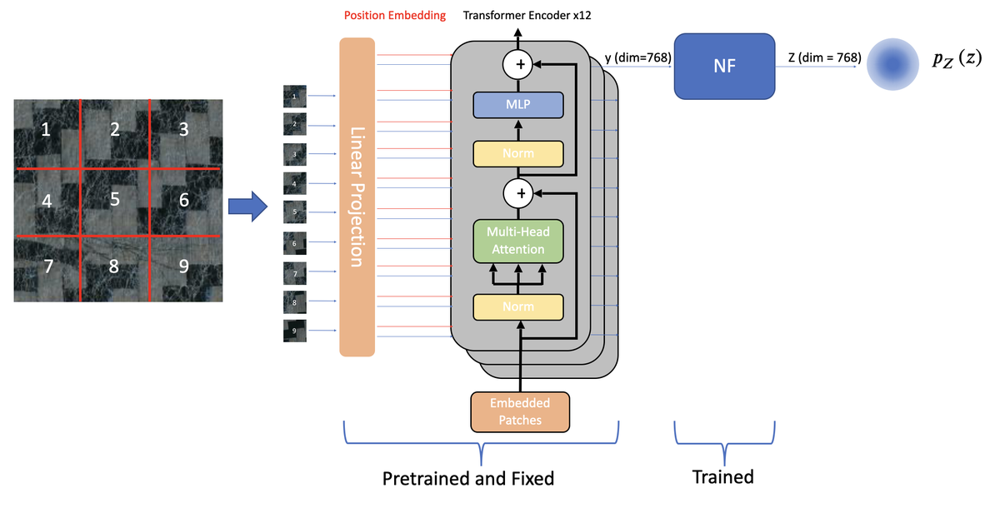
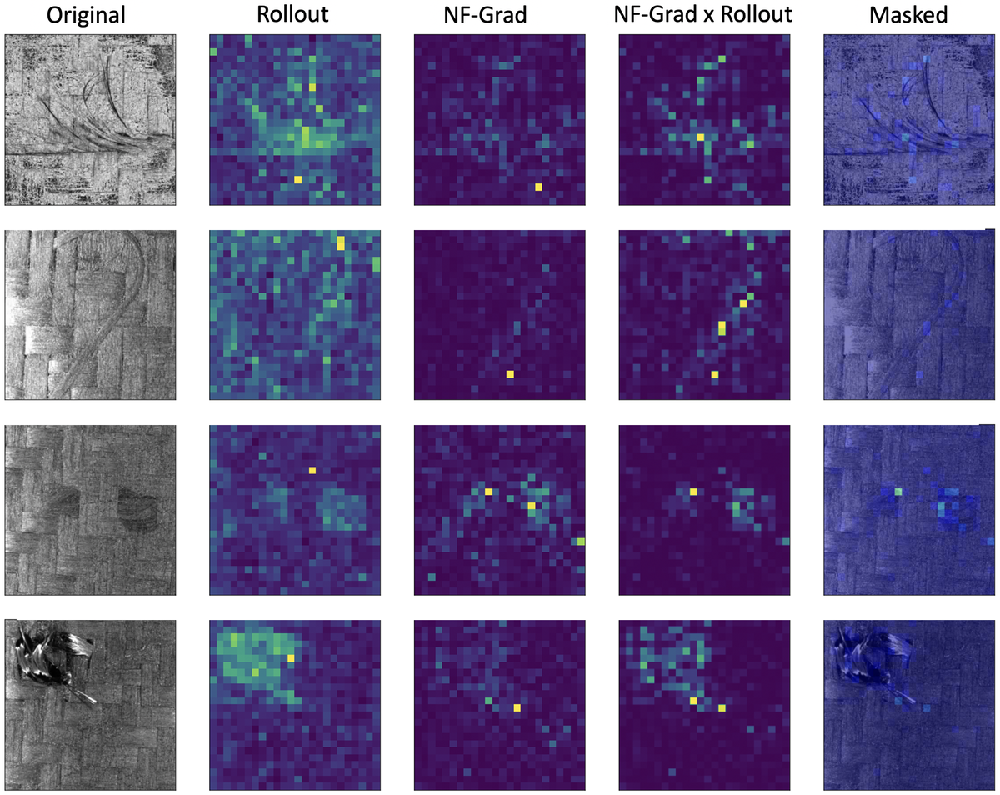

# Unsupervised Defect Detection for Dry Carbon Fiber Textiles (ViT + Normalizing Flow)

Code for the paper **"An Unsupervised Defect Detection Model for a Dry Carbon Fiber Textile"**
by Martin Szarski and Sunita Chauhan (Monash University), *Journal of Intelligent Manufacturing* (2022).

The model detects defects in carbon fiber fabric using **only defect-free ("normal") images** for training.
A frozen, pretrained **Vision Transformer (ViT-B/16)** encoder extracts a global image feature, and a
**RealNVP-style normalizing flow** (as in [DifferNet](https://github.com/marco-rudolph/differnet)) learns the
likelihood of those features. The negative log-likelihood of an image is its anomaly score. Interpretable
anomaly maps come from multiplying **ViT attention rollout** by the **gradient of the likelihood** with
respect to the input.



## Highlights

- **Unsupervised:** trained on 150 normal scans; no defect examples are needed for training.
- **Carbon fabric (T700 2x2 twill, photometric stereo):** 100% AUROC on 34 real defects across 14 FAA defect
  classes, including stray fibers covering about 1% of the image, where DifferNet scores 97.5%.
- **MVTec-AD Textures:** 98.1% mean AUROC, against 94.6% for DifferNet. Grid improves by 8 points and Carpet by 6.
- **Interpretable:** anomaly maps from attention rollout × NF gradient.
- **Real-time:** about 32 ms per image at 384×384.

### Results (% image-level AUROC)

| Dataset                                     | DifferNet | **Ours** |
|---------------------------------------------|:---------:|:--------:|
| Carbon fabric, all defects (min 4 mm²)      | 97.5      | **100**  |
| Carbon fabric, no stray fibers (min 25 mm²) | 100       | **100**  |
| MVTec-AD Grid                               | 84.0      | **92.2** |
| MVTec-AD Leather                            | 97.1      | **100**  |
| MVTec-AD Tile                               | 99.4      | **99.6** |
| MVTec-AD Carpet                             | 92.9      | **99.3** |
| MVTec-AD Wood                               | **99.8**  | 99.6     |
| **MVTec-AD Texture average**                | 94.6      | **98.1** |

### Anomaly maps



## Method

1. **Input:** a 384×384 image. For the carbon fabric data, the photometric-stereo *specular* channel is
   repeated to make 3 channels and normalized with ImageNet statistics.
2. **Feature extractor:** ViT-B/16 at 384 px (12 layers, 768-dimensional embedding). The classification head
   is removed, the `[CLS]` token after the final LayerNorm is used as the feature, and the weights are frozen.
3. **Normalizing flow:** 8 coupling blocks (random permutation followed by a GLOW coupling layer), with
   2048-unit fully connected subnetworks and clamp α = 3, built on DifferNet's FrEIA-based layers.
4. **Training loss:** negative log-likelihood under a standard normal, `‖z‖²/2 − log|det J|`.
5. **Anomaly score:** `mean(z²)` per image.
6. **Localization:** the input gradient of the NF loss (pooled to the 24×24 patch grid) multiplied by
   attention rollout over all 12 ViT layers (Abnar & Zuidema, 2020).

## Repository contents

| File | Description |
|------|-------------|
| `Transformer_NF_Anomaly.ipynb` | End-to-end notebook: data loading, ViT + NF model, training/evaluation (AUROC), score histograms, timing, and attention-rollout × gradient anomaly maps. |
| `assets/` | Figures from the paper. |
| `LICENSE` | MIT. |

## Getting started

The notebook was written for **Google Colab with a GPU** in late 2020 (Python 3.6, PyTorch 1.7, timm 0.3.2).

```bash
pip install torch torchvision "timm==0.3.2" einops scikit-learn scipy matplotlib tqdm opencv-python
git clone https://github.com/mszarski/differnet   # provides freia_funcs (normalizing-flow layers)
```

Then open `Transformer_NF_Anomaly.ipynb` and set `dataset_path` and `class_name` in the data-settings cell.

**Notes**

- **timm version:** the notebook uses the old `timm.models.helpers.load_pretrained` and `timm.models.layers`
  APIs, so pin `timm==0.3.2` or adapt the weight loading for newer releases. The pretrained weights
  (`jx_vit_base_p16_384`) are downloaded automatically from the timm releases.
- **`differnet` folder:** the `differnet` clone must be on `sys.path`. The notebook adds it with
  `sys.path.append("differnet")`.
- **Input channel:** `RepeatSingleChannelInto3DFromTensor(2)` picks channel 2 of the input image (the specular
  feature in our stacked data). For ordinary RGB datasets such as MVTec-AD, remove this transform or swap in
  `ChannelMeanInto3DFromTensor()`.
- **Training length:** training runs for `meta_epochs × sub_epochs` epochs (2 × 24 = 48 in the paper), with
  evaluation after each meta-epoch. The best AUROC is reported.

### Dataset layout

The data is loaded with `torchvision.datasets.ImageFolder`, in an MVTec-AD-style layout:

```
<dataset_path>/<class_name>/
├── train/
│   └── good/            # normal images only
└── test/
    ├── good/            # normal images  -> must be label 0
    ├── <defect_type_1>/ # anomalous images
    └── <defect_type_2>/
```

`ImageFolder` assigns labels in alphabetical order, and the evaluation treats label 0 as normal. Make sure the
normal folder sorts first. `good` comes before most defect names, but check this for your own data.

## Data availability

The carbon fiber dataset was collected under a confidentiality agreement and is **not public**. Please contact
the authors. MVTec-AD is available under license from
[mvtec.com](https://www.mvtec.com/company/research/datasets/mvtec-ad).

## Citation

```bibtex
@article{szarski2022unsupervised,
  title   = {An Unsupervised Defect Detection Model for a Dry Carbon Fiber Textile},
  author  = {Szarski, Martin and Chauhan, Sunita},
  journal = {Journal of Intelligent Manufacturing},
  volume  = {33},
  pages   = {2075--2092},
  year    = {2022},
  doi     = {10.1007/s10845-022-01964-z}
}
```

## Acknowledgements

This code builds on [DifferNet](https://github.com/marco-rudolph/differnet) (Rudolph et al., 2021),
[FrEIA](https://github.com/VLL-HD/FrEIA), [timm](https://github.com/huggingface/pytorch-image-models)
(Wightman), and the attention-rollout implementation of Chefer et al. Thanks to Dr. Luke Fletcher for review.
Carbon fabric data was provided by Boeing and captured with a photometric stereo system from Profactor GmbH.

## License

[MIT](LICENSE) © 2022 Martin Szarski
